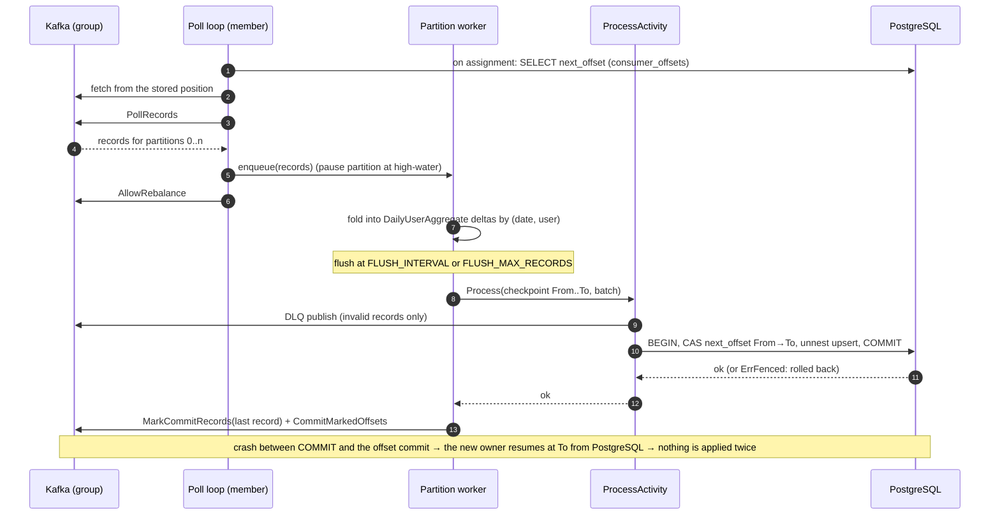

# ADR 0008: Consumer concurrency, batching and delivery semantics

- **Status:** Accepted
- **Date:** 2026-10-11
- **Amended:** 2026-10-12 — **Option A**: the consumer stores its Kafka positions in PostgreSQL, in the same transaction as the aggregates, and resumes from them on assignment. Delivery moves from at-least-once with a bounded overcount to **effectively once per partition**. Why a separate table: [addendum](0008a-separate-offset-table-justification.md).
- **Amended:** 2026-10-12 — **fence recovery**: a fenced partition is resumed in place from the reloaded stored position instead of stalling until the next rebalance.
- **Scope:** consumer

> **TL;DR** — One worker goroutine per partition folds records into per-(date, user) deltas and flushes in one PostgreSQL transaction that also compare-and-sets the partition position in `consumer_offsets`. This gives effectively-once delivery per partition, and a stale owner is fenced and resumed in place. Trade-off: a second table and two extra round trips per flush; client HTTP retries still double count.

## Context

- The challenge awards bonus points if the service "can be scaled horizontally by adding more consumers", and notes that they "can be run in separate goroutines within the same service".
- The summary (§8) requires "offset-commit behavior … aligned with successful processing so failures do not silently lose work".
- `incoming.user_activity` has **6 partitions** and is keyed by `user_id` ([ADR 0007](0007-kafka-client-and-topic-topology.md)). Every event of a user lands in one partition, so one `activity_aggregates` row is never written from two partitions.
- The upsert adds deltas and is **not idempotent** ([ADR 0009](0009-aggregation-data-model.md)). The payload has no event ID ([ADR 0006](0006-event-contract-and-json-serialization.md)).
- One upsert round trip per event would make PostgreSQL the bottleneck. The counters are commutative, so events of the same `(activity_date, user_id)` can be folded before writing.
- Committing offsets to Kafka after the database commit (the first version of this ADR) leaves a window: a crash between the two commits re-applies the last batch of a partition. The load tests measured it (up to +455 events after `crash-kafka-stop`). Kafka transactions cannot close it, because the sink is PostgreSQL. Storing the position **with the output**, in one PostgreSQL transaction, can (Kafka documentation, "Message Delivery Semantics": https://kafka.apache.org/43/design/design/).

## Decision

### Group members

- One consumer process runs `CONSUMER_WORKERS` (default **3**) group members. Each member is its own franz-go `kgo.Client` with its own poll loop, started under the process `errgroup`.
- More processes join the same group with `docker compose up --scale consumer=N`. In-process members and replicas are all members of **one** group (`CONSUMER_GROUP`).
- The partition count caps parallelism. At most 6 members own partitions; extra members stay idle as hot standbys and take over on rebalance.

### One worker goroutine per assigned partition

Each member is created with these options (names verified against the franz-go source of the version in [ADR 0001](0001-versions-and-upgrade-policy.md)):

```go
cl, err := kgo.NewClient(
	kgo.SeedBrokers(cfg.Brokers...),
	kgo.ConsumerGroup(cfg.Group),
	kgo.ConsumeTopics(cfg.Topic),
	kgo.ConsumeResetOffset(kgo.NewOffset().AtStart()), // no stored position, no commit: start at the beginning, lose nothing
	kgo.Balancers(kgo.CooperativeStickyBalancer()),
	kgo.AutoCommitMarks(),                             // only marked (= persisted) records are committed to Kafka
	kgo.BlockRebalanceOnPoll(),                        // callbacks never run while we hand out a poll
	kgo.OnPartitionsAssigned(m.onAssigned),
	kgo.OnPartitionsRevoked(m.onRevoked),
	kgo.OnPartitionsLost(m.onLost),
	kgo.AdjustFetchOffsetsFn(m.adjustOffsets),         // resume from the positions stored in PostgreSQL
)
```

- **Assigned:** start one worker goroutine per partition, each with a bounded queue.
- **Positions loaded (`AdjustFetchOffsetsFn`):** franz-go calls it after `OnPartitionsAssigned` and after the group's `OffsetFetch`, before the new partitions are fetched, with the offsets it is about to use. The member reads the stored positions of those partitions (one primary-key lookup, `NextOffsets`) and replaces each Kafka offset with the stored `next_offset` (`kgo.NewOffset().At(next)`, epoch -1). Each worker learns the position it must present on its first flush. Details below.
- **Poll loop:** `PollRecords` → `EachPartition` → send that partition's records to its worker → `AllowRebalance()`. The send never blocks. When a worker's queue reaches its high-water mark, the poll loop calls `PauseFetchPartitions` for that partition. The worker calls `ResumeFetchPartitions` once it has drained. A slow or retrying partition stops fetching. It never stalls the poll loop, the other partitions or the rebalance protocol.
- **Revoked** (rebalance or our own shutdown): stop the workers of the revoked partitions. Each one folds what is already queued, flushes within `REVOKE_FLUSH_TIMEOUT` (default 10 s, well below the group rebalance timeout), and marks. The callback then runs `CommitMarkedOffsets`. If a flush cannot finish in time (for example, the DB is down), the worker drops its unflushed batch. Its stored position did not move, so the new owner re-reads exactly those records.
- **Lost** (session expired, fenced): stop the workers and drop everything not yet written. **Do not commit to Kafka.** The partitions already belong to someone else. A flush that was already in flight is harmless: if it commits, it moved the stored position, and the new owner either loaded that position or is fenced by it (below).

A naive shared worker pool was rejected. It processes one partition's records out of order, so "everything up to offset N is done" could no longer be stored safely.

### Micro-batching per partition

Each worker folds records into a map keyed by `(activity_date, user_id)`, holding one `DailyUserAggregate` delta per key. It flushes when the **first** of these happens:

| Trigger | Config | Default |
|---|---|---|
| Time since the first record of the batch | `FLUSH_INTERVAL` | `1s` |
| Records in the batch | `FLUSH_MAX_RECORDS` | `500` |
| Partition revoked or shutdown | — | — |

**Decoding happens in the Kafka adapter, per record, as it arrives.** It maps the wire DTO to `domain.NewActivityEvent` ([ADR 0006](0006-event-contract-and-json-serialization.md)). A record that fails decoding or validation becomes a `ports.DeadLetter` (original key/value bytes, partition/offset coordinates, error class). The application layer never sees JSON. The batch handed to the use case is `ProcessActivity.Process(ctx, checkpoint, events, rejected)`, where `ports.Checkpoint{Group, Topic, Partition, From, To}` says which part of the partition the batch covers: `From` is the stored position the worker loaded or last wrote (`ports.NoPosition` if none exists yet) and `To` is the offset of the batch's last record plus one, dead letters included.

A flush is one call to the `ProcessActivity` use case:

1. `Rejected` records are published to the DLQ through `DeadLetterPublisher` ([ADR 0011](0011-failure-handling-retry-and-dlq.md)).
2. `AggregateRepository.ApplyDeltas(ctx, checkpoint, deltas)` runs **one transaction**: a compare-and-set that moves the partition's row in `consumer_offsets` from `From` to `To` (or creates it when `From` is `NoPosition`), then **one** batched `unnest` upsert of the deltas ([ADR 0009](0009-aggregation-data-model.md), [ADR 0010](0010-postgresql-access-and-migrations.md)). Keys are sorted, and each appears once. A batch made only of dead letters still runs the transaction, so the position moves past them.
3. After the transaction commits, the worker calls `MarkCommitRecords(last)` with the last record of the batch, then `CommitMarkedOffsets(ctx)` (the client is safe for concurrent use). `AutoCommitMarks` keeps committing marks in the background. These Kafka commits keep `kafka-consumer-groups.sh` and `consumer_lag_records` meaningful; they are **not** the source of truth.

The worst-case latency from the Kafka ack to a visible aggregate is about `FLUSH_INTERVAL` plus one transaction. With 6 partitions there are at most 6 concurrent transactions, each covering up to 500 events.



### Delivery semantics: effectively once per partition

The position of every partition lives in PostgreSQL, next to the aggregates it produced (migration `00002`, [ADR 0010](0010-postgresql-access-and-migrations.md)):

```sql
CREATE TABLE consumer_offsets (
    consumer_group TEXT NOT NULL,
    topic          TEXT NOT NULL,
    partition      INT NOT NULL,
    next_offset    BIGINT NOT NULL,  -- next offset to read: last applied record + 1
    updated_at     TIMESTAMPTZ NOT NULL DEFAULT NOW(),
    PRIMARY KEY (consumer_group, topic, partition),
    CHECK (partition >= 0),
    CHECK (next_offset >= 0)
);
```

**Writing (fencing).** The position moves only with a compare-and-set in the flush transaction: `UPDATE … SET next_offset = To WHERE … AND next_offset = From`, or `INSERT … ON CONFLICT DO NOTHING` when the worker expects no row. If it matches no row, the transaction rolls back and nothing of the batch is written:

- if the stored position already equals `To`, an earlier attempt of this very batch committed (the reply to `COMMIT` was lost and the worker retried). `ApplyDeltas` returns success; the batch is not applied again.
- otherwise another owner moved the position. `ApplyDeltas` returns an error wrapping `ports.ErrFenced`. The worker's position is stale: it drops the batch (no retry, no DLQ), increments `offset_fence_rejections_total` ([ADR 0013](0013-observability.md)), logs at ERROR, seals itself (no more Kafka marks), pauses fetching for the partition, asks its member for a **resync** and exits. The member then resumes the partition from the stored position (next section). If a rebalance takes the partition away first, it stops the dead worker, resumes fetching, and the next owner loads the stored position as usual.

**Fence recovery (resync).** *Amended 2026-10-12.* A fence does not tell *which* side is stale. If the fenced member is the rightful owner (a stale member moved the position just after the owner loaded it), stopping the partition until the next rebalance would stall it indefinitely, because a group that is otherwise stable never rebalances. So the member re-seeks the partition in place:

1. The fenced worker records the partition as "resync due" and cancels the member's current `PollRecords` (the poll runs under a per-iteration context), because the paused partition no longer returns records that would end the poll.
2. Back in the poll loop, **between `PollRecords` and `AllowRebalance`**, the member reloads the stored position (`NextOffsets`, the same retried and bounded load as on assignment), calls `SetOffsets` for that partition with the stored position, starts a fresh worker that presents it as `Checkpoint.From` (and first aligns the Kafka committed offset to it), and resumes fetching. `offset_fence_resyncs_total` counts it and a WARN line logs it.
3. If the load fails, the resync is retried after `RETRY_MAX_DELAY` (the poll then runs with that deadline). If no position is stored (only possible after an operator deleted the row), the partition stays stopped and an ERROR is logged.

Why this is safe, checked against the franz-go v1.22.1 source:

- `Client.SetOffsets` documents that during group consumption it must run outside the poll's dispatch, with revokes blocked and not concurrently with committing (`consumer.go`). With `BlockRebalanceOnPoll`, no `OnPartitions*` callback runs between `PollRecords` and `AllowRebalance`, so the partition cannot be revoked or lost during the seek, and the member map cannot change under it. The sealed worker marks nothing, and the new one marks nothing before its first flush, so no commit of this partition races the seek.
- `SetOffsets` goes through `assignPartitions(..., assignSetMatching, ...)`, which calls `stopSession`: every buffered fetch is dropped, so no record fetched from the old position reaches the new worker. When the polled position already equals the stored one, `applySetOffsets` skips the reassignment and the buffered data already starts there. The defensive check (records below the stored position are dropped) still applies.
- Fencing stays the only guard of "never applied twice". If the resynced member is in fact the stale one, its next flush is fenced again (the CAS fails), and it learns that it lost the partition at its next heartbeat (`onLost`). Two members can fence each other a few times while a zombie's session runs out; every batch is still applied by exactly one of them.
- Forcing a rejoin (`Client.ForceRebalance`) was rejected: with the cooperative-sticky balancer the member keeps the partition, so it is never "newly assigned" and `AdjustFetchOffsetsFn` does not run again.

Under `READ COMMITTED`, a second writer of the same row waits for the first one's row lock and re-checks its `WHERE` clause against the committed row, so two owners can never both move one position. A stale member that has not yet noticed it lost the partition therefore cannot apply a batch the new owner also applies.

**Reading (resume).** In `AdjustFetchOffsetsFn` the member loads the stored positions of the newly assigned partitions (retried with the flush backoff for at most `REVOKE_FLUSH_TIMEOUT`; if it still fails, the callback returns the error, franz-go ends the session, reports the partitions lost and rejoins, which loads them again):

| Stored position | Kafka committed offset | Fetch starts at | Notes |
|---|---|---|---|
| none | any, or none | the Kafka committed offset, else the reset policy (`AtStart`) | migration path from the at-least-once version; the first flush creates the row (`From = NoPosition`) |
| `n` | `< n` or none | `n` | crash between the DB commit and the Kafka commit. The worker also commits `n` to Kafka (`CommitRecords`) before its first batch, so the lag returns to 0 even if no further record arrives |
| `n` | `= n` | `n` | normal case |
| `n` | `> n` | `n` | not produced by this consumer; logged at WARN. An operator who wants to skip or replay must change the stored position (see Operations) |

As a defensive check, a worker drops every record whose offset is below its stored position before it reaches a batch (logged at WARN). With fetching starting at the stored position this does not happen; the check keeps "never applied twice" independent of the seek.

**What each former overcount window does now:**

| Window | Effect |
|---|---|
| The DB transaction commits, then the process crashes (`SIGKILL`, OOM) before the offset commit | The next owner resumes at the stored `To`. Nothing is applied twice. |
| The offset commit fails, and the partition is lost or revoked before a background commit succeeds | Same: Kafka's committed offset is behind, the stored one is not. `offset_commit_failures_total` is informational. |
| The `COMMIT` reaches the server, but the client loses the connection before the reply | The worker retries ([ADR 0011](0011-failure-handling-retry-and-dlq.md)). The retry finds the stored position equal to its `To` and succeeds without writing. |
| Two members believe they own a partition (a stale member after a session timeout) | The compare-and-set lets one of them move the position; the other is fenced and its batch rolled back. |

**Remaining caveats (outside "effectively once per partition"):**

- **Client retries.** A client that retries `POST /v1/activities` after a timeout or a 503 sends a second event with a new `event-id` ([ADR 0006](0006-event-contract-and-json-serialization.md)). Both are separate Kafka records and both are counted. Deduplicating them needs a client-supplied idempotency key and is **out of scope**.
- **The DLQ is still at-least-once.** Dead letters are published before the transaction. If that transaction then fails or is fenced, the retry (or the next owner) publishes them again. DLQ consumers must tolerate duplicates; the original topic/partition/offset headers identify them ([ADR 0011](0011-failure-handling-retry-and-dlq.md)).
- **A fence costs one batch round trip, not a stall.** A fenced worker drops its batch and the member resumes the partition from the stored position (fence recovery above), so the rightful owner continues without a restart or rebalance. While a stale member still reaches PostgreSQL after its session expired (for example, a process paused for longer than the session timeout), the two can fence each other until the stale one notices. It is visible: `offset_fence_rejections_total` and `offset_fence_resyncs_total` increase.

### Operations: resetting stored positions

PostgreSQL wins over Kafka. `kafka-consumer-groups.sh --reset-offsets` **alone** has no effect on a partition that has a stored position: the consumer seeks back to it (and logs a warning). Positions are changed in the database, as `analytics_owner` (the runtime role has no `DELETE`), with **every consumer stopped** (`docker compose stop consumer`), so no flush can race the change.

**Deleting the rows, keeping the positions** (for example, before a topic is re-created, or to "truncate" the table). Without a row, a partition falls back to the group's Kafka committed offset. A bare `TRUNCATE consumer_offsets` is therefore only safe if Kafka's committed offsets equal the stored positions. After a clean shutdown they normally do; after a crash Kafka can be behind, and the consumer would apply the gap a second time. The controlled cut-over is:

1. Stop all consumers and wait until none is a group member (`kafka-consumer-groups.sh --describe --group analytics-consumer` shows no active members).
2. Export the positions and commit them to Kafka:

   ```bash
   docker compose exec -T postgres psql -U analytics_owner -d analytics -At -F, \
     -c "SELECT topic, partition, next_offset FROM consumer_offsets WHERE consumer_group = 'analytics-consumer' ORDER BY partition" \
     > positions.csv
   docker compose cp positions.csv kafka:/tmp/positions.csv
   docker compose exec kafka /opt/kafka/bin/kafka-consumer-groups.sh --bootstrap-server kafka:9092 \
     --group analytics-consumer --reset-offsets --from-file /tmp/positions.csv --execute
   ```

3. Check that `--describe` shows those offsets, then delete the rows: `DELETE FROM consumer_offsets WHERE consumer_group = 'analytics-consumer';`
4. Start the consumers. Each first flush creates its row again.

**Changing the partition count.**

- *Adding partitions to the existing topic* (`kafka-topics.sh --alter --partitions`) does not move or renumber existing records, so the stored positions of the existing partitions stay valid and need no reset. The new partitions have no row and start from the reset policy (`AtStart`, nothing is lost). Keys are re-mapped from then on: a user's new events can land in another partition than their old ones. The counters are commutative, so the totals stay correct; only per-user ordering across the change is lost, which aggregation does not need.
- *Re-creating the topic* (or moving to a new topic with a different partition count), when offsets restart at 0: rows left for the old incarnation are **wrong** and must be removed before any consumer starts. Otherwise the consumer seeks to the old position: beyond the new log end, Kafka answers "offset out of range", the reset policy restarts at offset 0, and the defensive check then drops every record below the old position as "already applied", silently. Drain the old topic first (lag 0), stop the consumers, delete the rows of that topic as above, make sure the group has no stale Kafka offsets for it (`kafka-consumer-groups.sh --group analytics-consumer --reset-offsets --to-earliest --topic <topic> --execute`), then start the consumers.

## Alternatives considered

| Option | Verdict | Reason |
|---|---|---|
| Goroutine per partition + micro-batch + positions stored with the aggregates (this ADR) | Chosen | Preserves per-partition order, batches writes, and applies each batch exactly once per partition. |
| Same, but positions only in Kafka (commit after the DB write) | Superseded (2026-10-12) | It was the first version of this ADR: at-least-once, with an overcount of up to one batch per partition after a crash or a failed commit. Measured in the load tests. |
| Positions as columns of `activity_aggregates` (option B) | Rejected | Possible, but recovery needs an `O(N)` scan or a secondary index on every write, and it mixes transport metadata into the business table. See the [addendum](0008a-separate-offset-table-justification.md). |
| One record per transaction, commit per record | Rejected | 500× more round trips and commits for the same correctness. |
| Shared worker pool across partitions | Rejected | Reorders records within a partition and needs a watermark tracker to store positions safely. Order-preserving parallelism is already given by partitions. |
| Kafka auto-commit on a timer | Rejected | Commits fetched-but-unprocessed records: data loss on crash. |
| Per-event dedupe table (`event_id` primary key) | Rejected | Grows without bound and needs TTL cleanup. The `event-id` header is producer-generated, so retries of the same HTTP request already get new IDs ([ADR 0006](0006-event-contract-and-json-serialization.md)): it would not remove client duplicates either. |
| Seek with `OnPartitionsAssigned` + `SetOffsets` | Rejected | `OnPartitionsAssigned` runs before the group's `OffsetFetch`, whose result is then assigned and would replace the seek; franz-go also documents `SetOffsets` as unsafe during group consumption with concurrent commits. `AdjustFetchOffsetsFn` is the hook designed for "adjust offsets before consumption begins". |
| Kafka transactions / exactly-once | Rejected | They cover Kafka-to-Kafka only. The sink is PostgreSQL, which cannot join a Kafka transaction. |
| One member per process only (scale with replicas) | Rejected as the only option | The challenge explicitly suggests goroutines in one service. We support both. |

## Consequences

**Positive**
- Horizontal scaling both ways (goroutines and replicas), with one clear cap: the partition count.
- Per-partition ordering, and each record applied once per partition whatever crashes: the load tests assert `SUM(activity_count) = input topic records − DLQ records` ([ADR 0016](0016-load-and-crash-testing.md)).
- About 500× fewer statements than per-event writes under load; small, predictable transactions.
- A blocked partition (DB outage, slow write) pauses only itself.
- Kafka tooling keeps working: offsets are still committed to Kafka after every flush.

**Negative / trade-offs**
- A second table and a compare-and-set per flush (two extra round trips). Mitigation: the table has one row per partition and is reached only by its primary key.
- Two places hold a position and they can differ (Kafka behind PostgreSQL after a crash). Mitigation: PostgreSQL always wins; a new owner aligns Kafka before its first batch; the operations section explains how to change positions safely.
- A fence drops one batch and re-reads it from the stored position (fence recovery). Mitigation: rare (needs a stale member that still reaches PostgreSQL); `offset_fence_rejections_total` and `offset_fence_resyncs_total` make it visible; no restart is needed.
- Client HTTP retries still produce duplicates. Mitigation: out of scope; documented in the README.
- Up to `FLUSH_INTERVAL` of extra latency before aggregates are visible. Mitigation: configurable; 1 s is fine for analytics.
- More than 6 active members needs more partitions, which remaps keys. Mitigation: plan partition growth ahead of time ([ADR 0007](0007-kafka-client-and-topic-topology.md)) and follow the operations section.
- Rebalance callbacks contain real logic. Mitigation: unit tests with fakes, plus integration tests that scale members up and down while producing and that crash between the two commits.

## Implementation rules

- A batch's aggregate deltas and the move of its partition's stored position MUST be written in **one** PostgreSQL transaction. The position MUST be moved with a compare-and-set against the position the worker loaded or last wrote (`Checkpoint.From`), or created with `INSERT … ON CONFLICT DO NOTHING` when the worker expects none.
- A compare-and-set that matches no row MUST roll back the whole batch. If the stored position equals `Checkpoint.To` the call MUST succeed without writing; otherwise it MUST return an error wrapping `ports.ErrFenced`. The worker MUST NOT retry it, MUST NOT send the batch to the DLQ, MUST NOT mark it, MUST count it in `offset_fence_rejections_total` and MUST stop. The member MUST then resume the partition from the reloaded stored position (`SetOffsets` only between `PollRecords` and `AllowRebalance`, a fresh worker with that position as `From`), unless the partition was revoked or lost first.
- Dead-lettered records MUST advance the stored position in the transaction of the batch they belong to.
- On assignment, fetching MUST start at the stored position when one exists (`AdjustFetchOffsetsFn`); without one, the Kafka committed offset or the reset policy applies. Records below the stored position MUST be dropped before they reach a batch.
- Offsets MUST still be committed to Kafka, only for records whose batch committed in PostgreSQL (or parked in the DLQ). Plain auto-commit MUST NOT be used; only `AutoCommitMarks` with explicit marks.
- Each assigned partition MUST have exactly one worker goroutine, owned by the member and stopped on revoke, lost and shutdown. No goroutine may outlive its member.
- The poll loop MUST NOT block on a worker. Backpressure MUST use `PauseFetchPartitions`/`ResumeFetchPartitions`, and `AllowRebalance` MUST be called after every poll.
- A batch MUST fold events into at most one `DailyUserAggregate` per `(activity_date, user_id)` and be written with one upsert statement in that one transaction.
- `onRevoked` MUST flush and commit within `REVOKE_FLUSH_TIMEOUT`. `onLost` MUST NOT commit to Kafka.
- Callbacks MUST NOT call `Close` or `LeaveGroup` synchronously (franz-go deadlocks).
- `CONSUMER_WORKERS`, `FLUSH_INTERVAL`, `FLUSH_MAX_RECORDS` and `REVOKE_FLUSH_TIMEOUT` MUST be validated at startup (`> 0`) and listed in `.env.example`.
- The core (domain, ports, application) MUST express positions as `ports.Checkpoint` and `ports.ErrFenced`; franz-go and pgx types MUST NOT leak into it.
- Tests MUST cover: a flush on size and on time; a revoke mid-batch (flush + commit); a lost partition (no commit); a fenced batch (dropped, worker stopped, no retry) and the resync that follows (seek to the reloaded position, fresh worker, no resync of a revoked partition, retry of a failed load); the compare-and-set (create, advance, mismatch, already applied, rollback with the upsert, two concurrent owners); and a crash between the DB commit and the offset commit (**no** record counted twice, Kafka aligned afterwards).

## Related

- [ADR 0008 addendum](0008a-separate-offset-table-justification.md) — why the positions live in a separate table (option A) and not in `activity_aggregates` (option B).
- [ADR 0007](0007-kafka-client-and-topic-topology.md) — partition count and `user_id` key.
- [ADR 0009](0009-aggregation-data-model.md) — the upsert this ADR batches.
- [ADR 0011](0011-failure-handling-retry-and-dlq.md) — what happens when a flush fails.
- [ADR 0010](0010-postgresql-access-and-migrations.md) — the flush transaction, `consumer_offsets` migration, pool sizing.
- [ADR 0012](0012-lifecycle-and-graceful-shutdown.md) — shutdown uses the same flush-and-commit path as revoke.
- [ADR 0013](0013-observability.md) — `offset_fence_rejections_total`, `offset_commit_failures_total`, `consumer_lag_records`.
- [ADR 0001](0001-versions-and-upgrade-policy.md) — franz-go version.
- [ADR 0016](0016-load-and-crash-testing.md) — the effectively-once assertion in every load and crash run.

## References

- [1] Apache Kafka 4.3 documentation, "Design", sections "Consumer Position" and "Message Delivery Semantics". https://kafka.apache.org/43/design/design/. The design this ADR implements: the consumer stores its offset in the same place as its output instead of running a two-phase commit, and Kafka transactions cover the Kafka-to-Kafka case only.
- [2] Martin Kleppmann, *Designing Data-Intensive Applications*, 1st ed., O'Reilly Media, 2017, ISBN 978-1-4493-7332-0. Ch. 11, "Stream Processing", section "Fault Tolerance" (atomic commit revisited, idempotence); ch. 7, "Transactions", section "Preventing Lost Updates" (atomic writes, compare-and-set); ch. 12, "The Future of Data Systems", section "The End-to-End Argument for Databases". Effectively-once processing as idempotent effects plus a position stored with the output.
- [3] Martin Kleppmann, "How to do distributed locking", 8 February 2016. https://martin.kleppmann.com/2016/02/08/how-to-do-distributed-locking.html. A paused or partitioned owner can act after losing ownership; only a check at the resource (a fencing token, here the compare-and-set on `next_offset`) makes that safe.
- [4] PostgreSQL 18 documentation, "Transaction Isolation", section "Read Committed Isolation Level" (https://www.postgresql.org/docs/18/transaction-iso.html) and "INSERT" (https://www.postgresql.org/docs/18/sql-insert.html). A second writer of the same row waits for the first, then re-evaluates its `WHERE` clause on the committed row; `ON CONFLICT DO UPDATE` is atomic under concurrency.
- [5] franz-go v1.22.1, package `kgo`. https://pkg.go.dev/github.com/twmb/franz-go@v1.22.1/pkg/kgo. `AdjustFetchOffsetsFn`, `BlockRebalanceOnPoll`, `AutoCommitMarks`, `Client.SetOffsets`, `PauseFetchPartitions` and the `OnPartitions*` callbacks as used here; the source-level checks in "Fence recovery" were made against this version.
- [6] Apache Kafka, KIP-429: Kafka Consumer Incremental Rebalance Protocol. https://cwiki.apache.org/confluence/display/KAFKA/KIP-429%3A+Kafka+Consumer+Incremental+Rebalance+Protocol. Cooperative rebalancing, which keeps the assigned partitions of a member across a rebalance.
- [7] Gwen Shapira, Todd Palino, Rajini Sivaram and Krit Petty, *Kafka: The Definitive Guide*, 2nd ed., O'Reilly Media, 2021, ISBN 978-1-4920-4308-9, ch. 4 "Kafka Consumers" (commits, rebalance listeners, seeking to specific offsets) and ch. 8 "Exactly-Once Semantics" (idempotent producer, transactions and their scope).
- [8] Gregor Hohpe and Bobby Woolf, *Enterprise Integration Patterns*, Addison-Wesley, 2003, ISBN 978-0-321-20068-6, pattern "Idempotent Receiver". https://www.enterpriseintegrationpatterns.com/patterns/messaging/IdempotentReceiver.html. The pattern behind the rejected per-event dedupe table and the chosen position check.
