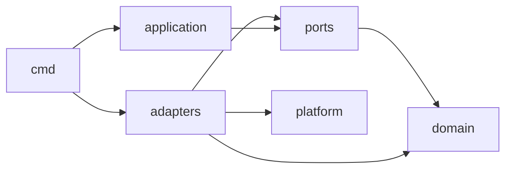
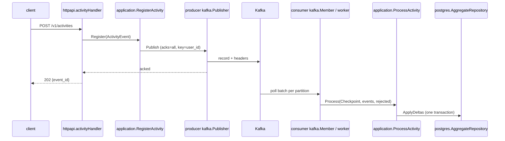

# Architecture

Two independent Go modules, one per service, each hexagonal (ports and adapters) with manual dependency injection. They never import each other and share only the event contract in `contracts/`. Deployment shape: one Compose stack (`compose.yaml`) with Kafka, Postgres, two one-shot jobs (`kafka-init`, `consumer-migrate`), the producer and a scalable consumer. The "why" of each decision is in the ADRs ([index](adrs/adr-index.md)); this file says where things are.

## Layers

Same layout in `services/producer/` and `services/consumer/`.

| Layer | Path (inside the service) | Responsibility | May import |
|---|---|---|---|
| Domain | `internal/domain/` | `ActivityEvent`, validation; consumer also `DailyUserAggregate` | stdlib only |
| Ports | `internal/ports/` | interfaces and sentinel errors the core needs | stdlib, domain |
| Application | `internal/application/` | use cases `RegisterActivity` (producer), `ProcessActivity`, `ResumePositions` (consumer) | domain, ports |
| Adapters | `internal/adapters/{httpapi,kafka,postgres}/` | HTTP, Kafka (franz-go), Postgres (pgx) | domain, ports, platform; never another adapter |
| Platform | `internal/platform/{config,retry,telemetry,tracectx}/` | env config, backoff, logger and metrics, W3C trace context | stdlib and libraries only |
| Composition root | `cmd/<service>/` | wiring, signals, shutdown order | everything |

## Dependency rules

Enforced by `scripts/check-boundaries.sh` (run by `make boundaries`). Each rule has a reason:
- `domain/` imports only the standard library and has no struct tags: the core must be testable without I/O and independent of the wire format.
- `ports/` imports only the standard library and `domain/`.
- `application/` never imports `adapters/` or `platform/`, and never logs: it returns errors, the edge decides.
- An adapter never imports another adapter: DTOs with `json` tags live in the adapter that owns the wire format (`httpapi` request DTO, `kafka` message DTO).
- `platform/` never imports domain, application or adapters.
- A service module never imports or requires the other one.

## Request flow

Producer: `activityHandler.ServeHTTP` in `services/producer/internal/adapters/httpapi/handler.go`; routes in `router.go`. Consumer: `Member` in `services/consumer/internal/adapters/kafka/member.go` owns the group client and one `worker` (`worker.go`) per assigned partition; `ProcessActivity.Process` in `services/consumer/internal/application/process_activity.go` folds a batch into one delta per (UTC date, user).

## Delivery guarantees

- 202 means the record is in Kafka: `Publisher.Publish` returns after the broker ack. Kafka failure or timeout gives 503 with `Retry-After`.
- Effectively once per Kafka record: `ApplyDeltas` writes the deltas and moves the partition position in `consumer_offsets` in one transaction, as a compare-and-set (`Checkpoint.From` to `Checkpoint.To`). On assignment the consumer resumes from the stored position (`Member.adjustOffsets`), not from the Kafka committed offset. Kafka offsets are still committed, for lag tooling only.
- A stale owner gets `ports.ErrFenced`; its worker stops and `Member.resyncFenced` restarts the partition from the stored position.
- Not covered: a client that retries `POST /v1/activities` creates a second record and is counted twice; a dead letter can appear twice in the DLQ.
- Transient errors (`ports.ErrUnavailable`) are retried without limit with backoff and never dead-lettered. Each flush attempt is bounded by `FLUSH_TIMEOUT` (`withAttemptTimeout` in `worker.go`).
- Permanent errors (decode, validation) go to `incoming.user_activity.dlq` through `ports.DeadLetterPublisher`, then the position advances.
- On SIGTERM or SIGINT both services drain in-flight work and exit within the 30 s Compose grace period (`stop_grace_period` in `compose.yaml`); consumers are static group members, so a restart within `CONSUMER_SESSION_TIMEOUT` takes its partitions back at once.
- Resetting offsets with `kafka-consumer-groups.sh --reset-offsets` has no effect while `consumer_offsets` has a row: see [ADR 0008](adrs/0008-consumer-concurrency-batching-and-delivery-semantics.md), "Operations".

Rationale: ADRs [0008](adrs/0008-consumer-concurrency-batching-and-delivery-semantics.md), [0008a](adrs/0008a-separate-offset-table-justification.md), [0011](adrs/0011-failure-handling-retry-and-dlq.md), [0012](adrs/0012-lifecycle-and-graceful-shutdown.md).

## External integrations

| System | Client in code | Direction | Notes |
|---|---|---|---|
| Kafka `incoming.user_activity` | `Publisher` in `services/producer/internal/adapters/kafka/publisher.go`; `Member` in `services/consumer/internal/adapters/kafka/member.go` | producer writes, consumer reads | 6 partitions, 7 days retention, key `user_id`; created by `deploy/kafka/create-topics.sh`, never by the services |
| Kafka `incoming.user_activity.dlq` | `DeadLetterPublisher` in `services/consumer/internal/adapters/kafka/dlq.go` | consumer writes | 3 partitions, 14 days retention; keeps the original bytes |
| PostgreSQL 18 | `AggregateRepository` in `services/consumer/internal/adapters/postgres/repository.go` | consumer reads and writes | runtime role `analytics_app`; migrations run by `consumer migrate` as the owner |

Operational endpoints: producer `GET /healthz`, `/readyz`, `/metrics` on the API port (8080); consumer the same three on 8081, not published. Contract: `services/producer/api/openapi.yaml`, event schema `contracts/user_activity.v1.schema.json`. The consumer binary has three commands, `run`, `migrate` and `healthcheck` (`services/consumer/cmd/consumer/main.go`).

## Where new code goes

- New endpoint (producer) → handler in `services/producer/internal/adapters/httpapi/`, registered in `router.go`, documented in `services/producer/api/openapi.yaml` (checked by `openapi_test.go`). Follow `handler.go`.
- New event field → `contracts/user_activity.v1.schema.json` and examples in `contracts/examples/`, then the domain type, the producer request DTO (`decode.go`), the producer message DTO (`kafka/message.go`) and the consumer message DTO (`kafka/message.go`). Both `contract_test.go` files run the examples.
- New use case → a type in `internal/application/`, its outbound interfaces in `internal/ports/`, wiring in `cmd/`.
- New table or column → migration `services/consumer/migrations/<seq>_<description>.sql` (goose, five-digit sequence as in `00001_create_activity_aggregates.sql`), including the `GRANT` to `analytics_app`. Runtime SQL stays in `repository.go`, with `$n` parameters only.
- New environment variable → read in `internal/platform/config/config.go` of the service, listed in `.env.example`, and set in `compose.yaml` if it differs from the default.
- New metric → `internal/platform/telemetry/metrics.go` (producer) or `internal/adapters/kafka/metrics.go` (consumer).
- New external integration → port in `internal/ports/`, client in a new adapter package, wiring in `cmd/`.

## Project-specific conventions

- `ActivityEvent` and its validation exist in both modules on purpose. Change them together; the shared `contracts/examples/` tests keep them aligned.
- Retry with backoff (`internal/platform/retry/`) runs in the consumer's partition worker (`worker.go`), in `Member.loadPositions` and in the startup checks of both services. The producer adds no retry around a publish (franz-go retries inside `PUBLISH_TIMEOUT`); after that the client decides, using the 503 and `Retry-After`.
- All dates are UTC. `ActivityEvent.ActivityDate` is the only way to derive the activity date.
- Run Go commands per module with `GOWORK=off`; each service builds on its own (`services/<service>/Dockerfile`).
