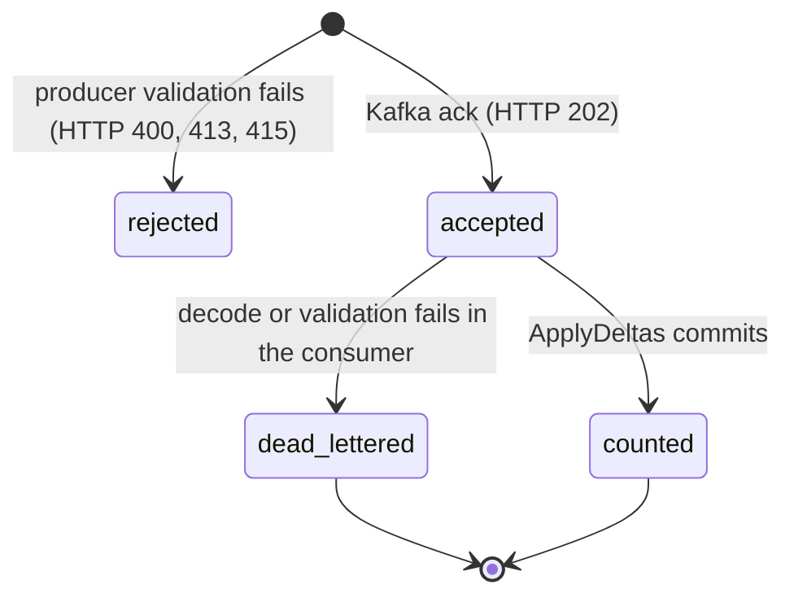

# Domain

Vocabulary and rules come from [ADR 0004](adrs/0004-domain-model-and-ubiquitous-language.md) and [ADR 0009](adrs/0009-aggregation-data-model.md). "Aggregate" means a SQL roll-up, not a DDD Aggregate.

## Glossary

| Business term | In code | Meaning |
|---|---|---|
| Activity event | `ActivityEvent` in `services/producer/internal/domain/activity.go` and `services/consumer/internal/domain/activity.go` | One user action: `UserID`, `ActivityType`, `Timestamp` (UTC), `Metadata`. Valid by construction (`NewActivityEvent`) |
| Activity type | `ActivityType`; constant `ActivityPageView` = `page_view` | Open-ended string. Only `page_view` has special meaning |
| Activity date | `ActivityEvent.ActivityDate` | UTC calendar day of the event `Timestamp`, not the day it was received |
| Daily user aggregate | `DailyUserAggregate` in `services/consumer/internal/domain/activity.go`; table `activity_aggregates` | Counters for one user on one UTC date. In code it is a delta to add, in the table it is the running total |
| Metadata | `ActivityEvent.Metadata` | Free-form string map (page URL, referrer). Passed to Kafka, never aggregated, never stored in Postgres |
| Event ID | `event-id` record header; `RegisterActivity.Register` return value | UUIDv7 for tracing and DLQ correlation only; never used to deduplicate |
| Stored position | `Checkpoint` in `services/consumer/internal/ports/ports.go`; table `consumer_offsets` | Next Kafka offset to read per (group, topic, partition), written in the same transaction as the counters |
| Dead letter | `DeadLetter` in `services/consumer/internal/ports/ports.go`; topic `incoming.user_activity.dlq` | A record that can never be processed (class `decode` or `validation`) |

## Entities

### ActivityEvent
- Defined in: `ActivityEvent` in both `domain/activity.go` files (see Glossary).
- Identity: none. Two identical events are two events.
- Wire format: JSON per `contracts/user_activity.v1.schema.json`, mapped by DTOs in the adapters.
- Limits (bytes, in `domain/activity.go`): `user_id` 1..128, `activity_type` 1..64 (both UTF-8, no control characters), at most 32 metadata entries, key 1..64, value up to 2048. HTTP body up to 64 KiB (`maxBodyBytes` in `services/producer/internal/adapters/httpapi/decode.go`).

### DailyUserAggregate
- Defined in: `DailyUserAggregate` in `services/consumer/internal/domain/activity.go`; persisted in `activity_aggregates` (`services/consumer/migrations/00001_create_activity_aggregates.sql`).
- Identity: `(activity_date, user_id)`, the primary key.
- Counters: `activity_count` (every accepted event), `page_view_count` (only `page_view`). `updated_at` is the database time of the last write, not an event time.

### Stored position
- Defined in: table `consumer_offsets` (`services/consumer/migrations/00002_create_consumer_offsets.sql`); key `(consumer_group, topic, partition)`.
- A row appears when the first batch of a partition is applied, so the table holds at most one row per partition (6 for `incoming.user_activity`), fewer on a fresh system.

## States and transitions

An event has no editable state. Its path through the pipeline:

- The stored position of a partition moves as follows: absent, then created with `Checkpoint.To` when `Checkpoint.From` is `ports.NoPosition`, then advanced from `From` to `To` (compare-and-set). Implemented in `ApplyDeltas` in `services/consumer/internal/adapters/postgres/repository.go`.
- A mismatch means another owner moved the position: `ports.ErrFenced`. If the stored value already equals `To`, an earlier attempt of the same batch committed and `ApplyDeltas` returns success without writing.
- Triggers: the producer decides `rejected` or `accepted` in `activityHandler.ServeHTTP`; the consumer decides `counted` or `dead_lettered` per record in `decodeRecord` in `services/consumer/internal/adapters/kafka/message.go`. A dead-lettered record still advances the position.

## Invariants

| Invariant | Enforced by | Where |
|---|---|---|
| One row per user per UTC day | database (PRIMARY KEY) | `00001_create_activity_aggregates.sql` |
| `activity_count >= 0`, `page_view_count >= 0`, `page_view_count <= activity_count` | database (CHECK) | `00001_create_activity_aggregates.sql` |
| One stored position per (group, topic, partition); `partition >= 0`, `next_offset >= 0` | database (PRIMARY KEY, CHECK) | `00002_create_consumer_offsets.sql` |
| Counters only grow by deltas, never read-modify-write | code | `upsertDeltas` in `services/consumer/internal/adapters/postgres/repository.go` |
| A batch is applied once per stored position | code (compare-and-set in one transaction) | `ApplyDeltas` in `repository.go` |
| Locks on `activity_aggregates` rows are taken in key order | code | `fold` in `services/consumer/internal/application/process_activity.go`, `columns` in `repository.go` |
| `user_id` and `activity_type` are bounded, valid UTF-8, free of control characters | code, in both services | `NewActivityEvent` in each `domain/activity.go` |
| The activity date is the UTC day of the timestamp | code | `ActivityEvent.ActivityDate` |
| Database rows equal records in the input topic minus records in the DLQ | tests only (load and crash runs) | `loadtest/report/verdict.go` |
| `timestamp` lies within a plausible range (not in the far past or future) | **nothing** | any RFC 3339 instant that is not the zero time is accepted |
| An event is counted once per client request | **nothing** | repeated or retried identical events are counted each time |
| `activity_type` belongs to a known list | **nothing, by design** | unknown types are accepted and counted in `activity_count` only |
| Counters never decrease | **nothing** | the runtime role may `UPDATE` the table; no trigger or constraint checks monotonic growth |

## Business rules

- Every accepted event adds 1 to `activity_count`. A `page_view` event also adds 1 to `page_view_count`. `DailyUserAggregate.Apply` in `services/consumer/internal/domain/activity.go`.
- Dates are UTC. An event with a non-UTC offset is converted first (`NewActivityEvent` normalizes `Timestamp` to UTC).
- Unknown activity types are accepted; only `page_view` is special-cased.
- Unique users are `COUNT(DISTINCT user_id)` over the whole date range, never a sum of daily counts. Page views and volume are `SUM` over the range. There is no query API; results are read with SQL ([ADR 0009](adrs/0009-aggregation-data-model.md)).
- Transient failures never discard an event; permanent ones park the original bytes in the DLQ ([ADR 0011](adrs/0011-failure-handling-retry-and-dlq.md)).
- Metadata is validated for size and passed through unchanged; it is not stored in Postgres.
